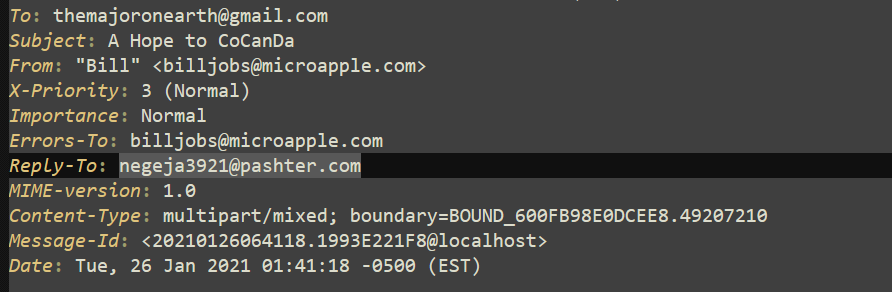
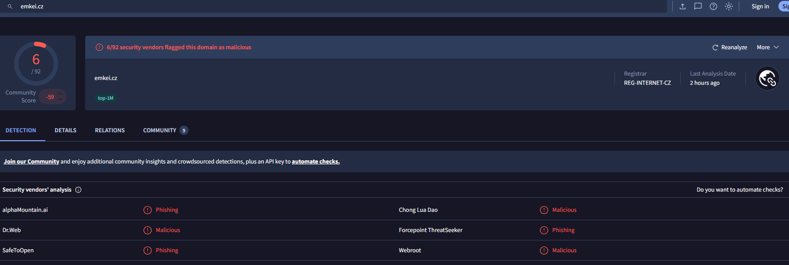
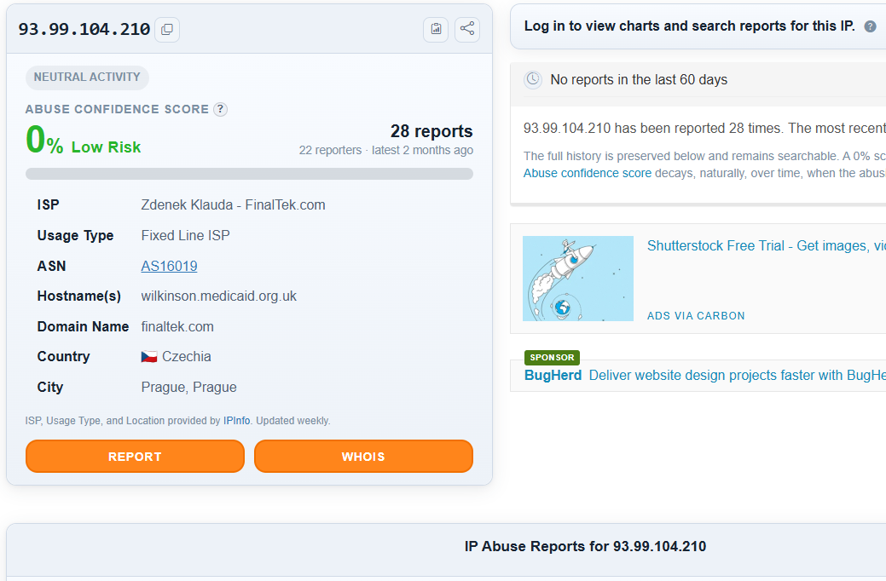
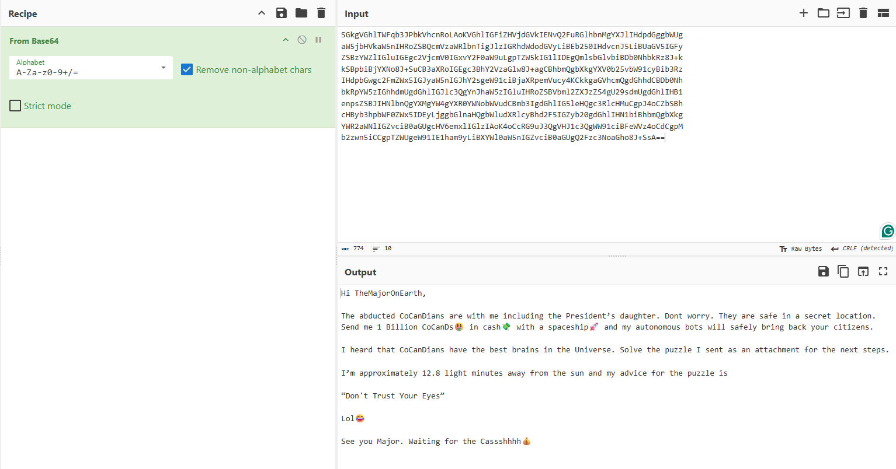
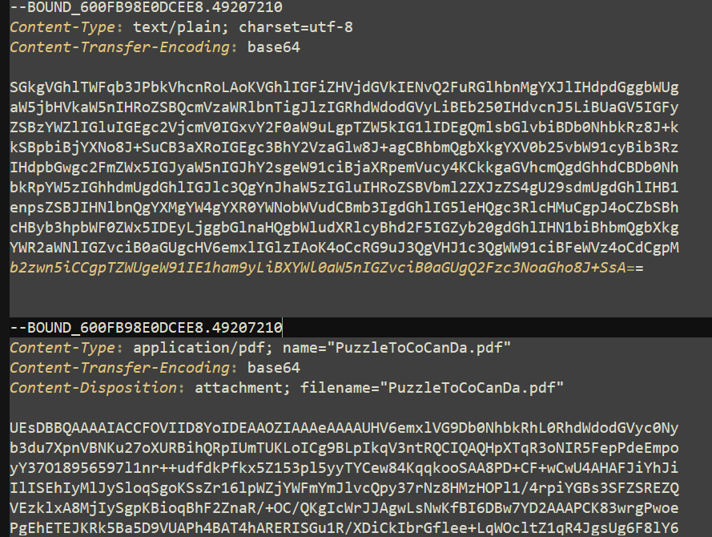
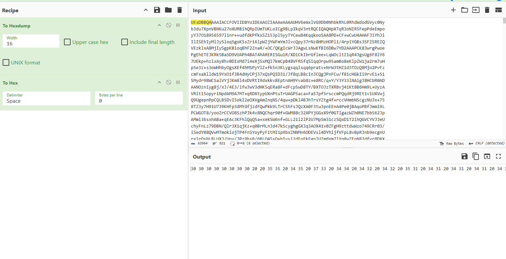
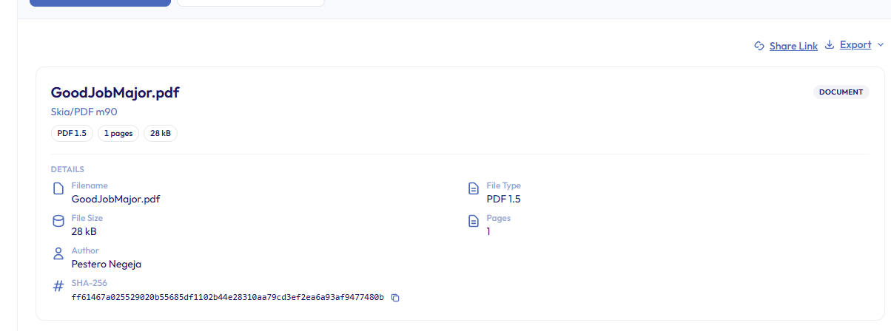
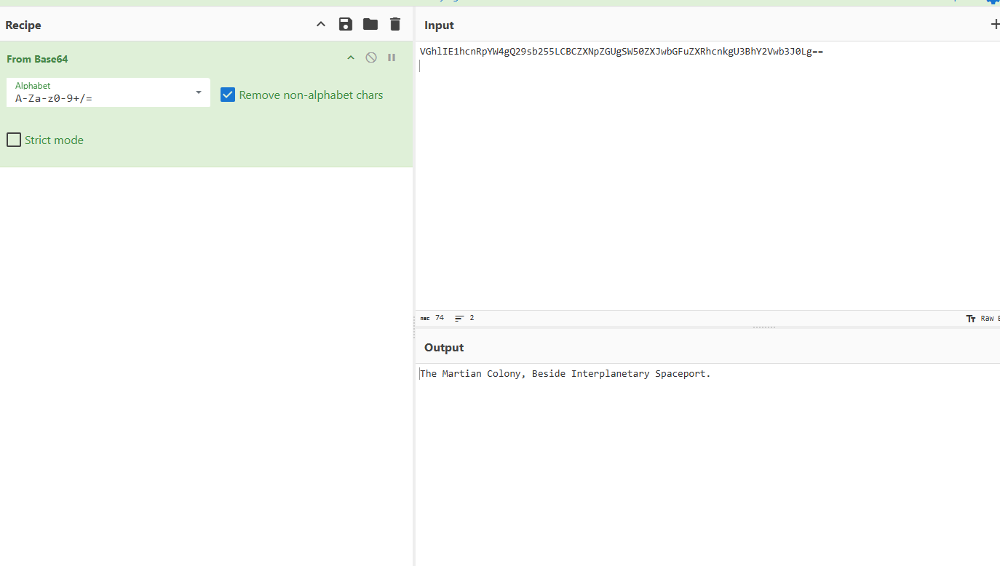

# The Planet’s Prestige — Email Investigation

This repository documents my investigation of **The Planet’s Prestige**, an email investigation challenge from Blue Team Labs Online.

## Investigation Report

A shorter, formal version of this investigation is available for SOC leads and managers.

[View the formal investigation report](Report.md)

## Project Information

**Platform:** [Blue Team Labs Online](https://blueteamlabs.online/home/challenge/the-planets-prestige-e5beb8e545)  
**Project Type:** Email Investigation  
**Status:** Documented

## Objective

The objective of this investigation is to analyze the provided email evidence, identify suspicious activity and indicators of compromise, and determine what occurred based on the available artifacts.

## Scenario

CoCanDa, a planet known as “The Heaven of the Universe”, has suffered a series of riots caused by the frequent abduction of citizens (CoCanDians) by a mysterious force. After a war-room meeting of leaders, the Planetary President learned that his daughter had also disappeared.

Two days later there was still no ransom demand and no clue about the whereabouts of the missing people. On the third day, a CoCanDa representative serving as an Army Major on Earth received a suspicious email.

The investigation begins with an analysis of that email to determine whether it contains information connected to the disappearances.

## Tools Used

- Notepad++
- CyberChef
- Gary Kessler’s File Signature Database
- VirusTotal
- AbuseIPDB
- Document metadata viewer

## Investigation Process

### 1. Initial Review

The provided evidence was an `.eml` file. I opened it in Notepad++ to review the raw email contents, including the headers, MIME structure, encoded message body, and attachment information.

The email was a multipart MIME message (`multipart/mixed`) containing a Base64-encoded plain-text body and an attachment.

### 2. Email Header Analysis

The visible sender was `billjobs[@]microapple[.]com`, while the `Reply-To` address was `negeja3921[@]pashter[.]com`. Replies would therefore go to a different domain than the one the message claimed to come from.

| Field | Value |
|---|---|
| To | `themajoronearth[@]gmail[.]com` |
| Subject | A Hope to CoCanDa |
| From | “Bill” `billjobs[@]microapple[.]com` |
| Errors-To | `billjobs[@]microapple[.]com` |
| Reply-To | `negeja3921[@]pashter[.]com` |
| Content-Type | `multipart/mixed; boundary=BOUND_600FB98E0DCEE8.49207210` |
| Message-Id | `<20210126064118.1993E221F8@localhost>` |
| Date (sent) | Tue, 26 Jan 2021 01:41:18 -0500 (EST) |

The `Message-Id` ends in `@localhost`, which is typical of a script or mailer service rather than a real mail server. The `Date` header is set by the sender, so it is treated as the claimed send time.

<strong>▶ Click to expand: Email-header evidence</strong>

The raw headers show the sender, the `Reply-To` mismatch, and the multipart MIME boundary.

#### Sending infrastructure

The message was sent through **emkei[.]cz**, a free online fake-mailer service. The sending IP, `93.99.104.210`, resolves to FinalTek (Prague, Czechia). This IP identifies the mailer service, not the attacker’s own machine.

- VirusTotal flagged `emkei[.]cz` as malicious/phishing by 6 of 92 vendors.
- AbuseIPDB lists 28 reports for `93.99.104.210` but a 0% confidence score, because the most recent report is about two months old.

<strong>▶ Click to expand: Reputation checks</strong>

VirusTotal result for `emkei[.]cz`:

AbuseIPDB result for `93.99.104.210`:

### 3. Email Body Analysis

The plain-text body was Base64-encoded. I decoded it in CyberChef using the `From Base64` operation.

The decoded message is addressed to “TheMajorOnEarth” and claims the abducted CoCanDians, including the President’s daughter, are safe in a secret location. It demands **1 Billion CoCanDs** in cash, to be delivered with a spaceship, and tells the Major to solve the puzzle in the attachment. It also gives a hint: **“Don’t Trust Your Eyes.”**

<strong>▶ Click to expand: Decoded email body</strong>

### 4. Attachment Analysis

The raw email contained an attachment named `PuzzleToCoCanDa.pdf`. Its MIME headers declared `application/pdf` with Base64 transfer encoding.

The Base64 data begins with `UEsDBBQA`, which decodes to the bytes `50 4B 03 04`. Gary Kessler’s file-signature reference identifies this as a **ZIP** archive, while a real PDF would begin with `25 50 44 46` (`%PDF`).

#### Attachment Findings

- **Declared filename:** `PuzzleToCoCanDa.pdf`
- **Declared content type:** `application/pdf`
- **Transfer encoding:** Base64
- **Observed file signature:** `50 4B 03 04`
- **Identified file type:** ZIP archive
- **Finding:** the attachment’s actual file type did not match its `.pdf` extension or declared MIME type.

<strong>▶ Click to expand: Attachment MIME data and signature</strong>

The attachment’s MIME headers and the start of its Base64 content:

The Base64 prefix `UEsDBBQA` (the ZIP signature) highlighted in CyberChef:

### 5. Extracted File Analysis

Extracting the archive produced three files: `GoodJobMajor.pdf`, `DaughtersCrown.jpeg` and `Money.xlsx`.

#### GoodJobMajor.pdf

The PDF states that the CoCanDians are safe, says the proof is in the file named `DaughtersCrown`, and says the location to send 1 Billion CoCanDs is in `Money.xlsx`.

The PDF metadata lists the **Author** as `Pestero Negeja` and the producer as `Skia/PDF m90`. This name matches the `negeja3921` Reply-To address and ties the document to the sender.

<strong>▶ Click to expand: GoodJobMajor.pdf metadata</strong>

#### DaughtersCrown.jpeg

The image shows a crown emoji. The PDF presents it as “proof”, but nothing in it ties it to the missing persons. It reads as a prop in the puzzle.

<strong>▶ Click to expand: DaughtersCrown image</strong>

#### Money.xlsx

The workbook reveals the attacker’s real message: *whatever has been seen or read until now is fake, the intention was not money, and this is the beginning of the war with the CoCanDians.* It also contains a Base64 string that I decoded in CyberChef.

The decoded string is the location: `The Martian Colony, Beside Interplanetary Spaceport.`

<strong>▶ Click to expand: Base64 decoding of the location</strong>

### 6. Findings Summary

- The sender address was spoofed using the free mailer **emkei[.]cz**, with a mismatched `Reply-To` pointing to `pashter[.]com`.
- The ransom demand was a decoy.
- The attachment was a ZIP archive disguised as a PDF.
- `Money.xlsx` revealed that the true intent was war with the CoCanDians, and hid the location in Base64.
- The PDF author, `Pestero Negeja`, matches the Reply-To mailbox.

## Indicators of Compromise

| Type | Value |
|---|---|
| Spoofed sender | `billjobs[@]microapple[.]com` |
| Reply-To / actor | `negeja3921[@]pashter[.]com` |
| Mail service | `emkei[.]cz` / `93.99.104.210` |
| Attachment | `PuzzleToCoCanDa.pdf` (actually a zip) |
| Contents | `GoodJobMajor.pdf`, `Money.xlsx`, `DaughtersCrown.jpeg` |
| Hidden location | Base64 in `Money.xlsx` |
| `GoodJobMajor.pdf` SHA-256 | `ff61467a025529020b55685df1102b44e28310aa79cd3ef2ea6a93af9477480b` |

## Conclusion

The email was malicious. It used sender spoofing, a mismatched Reply-To, a misleading file extension, and Base64-encoded content to conceal the attacker’s real intent.

By analyzing the raw email, decoding Base64 content, verifying the attachment’s file signature, and examining the recovered files, I identified the location the attacker disclosed:

`The Martian Colony, Beside Interplanetary Spaceport.`

Because the attacker states they will also be at that location, it should be verified before any rescue team is dispatched.
